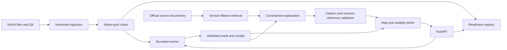

# Implementation specification

Status: target architecture, not a claim of implemented application behavior. Read PLAN.md first. Match this layout to existing repository conventions before moving application files.

Data-aligned update, 15 November 2026: all twelve regional inputs are delivered.
Use `packages/science/PLAN.md` for current numerical sequencing. The explicit
input contract in `scope.v2.json` distinguishes `source_variable` (provider)
from `cube_variable` (processed NetCDF field) and `cube_units`.
The numerical library can validate inputs independently of HTTP; final API
schema reconciliation and owner review remain required before integration.
Do not infer method approval from delivery claims on another branch.

## Module boundaries

```text
apps/web/                 React UI, map, charts, bilingual state
services/api/             HTTP contracts, jobs, catalog, receipts
packages/science/         deterministic preprocessing and statistics
packages/rag/             retrieval, interpretation, answer validation
data/nasa/                verified existing Egypt source bundle
data/derived/             generated analysis artifacts (not source truth)
docs/architecture/        decisions, scope, ownership and acceptance
```



## Data lifecycle

1. Discover the exact product/version and record the source-granule inventory.
2. Validate a representative file, its coordinate system, units, decoding and applicable QA flags.
3. Download regional subsets, preserving native grids, masks and source timestamps.
4. Verify expected months, coordinates, finite values, per-month valid coverage and hashes.
5. Publish immutable data_revision and measurement_ready=true only after checks pass.
6. Member 2 validates the scientific pipeline independently. This enables method_ready.
7. Member 6 verifies the end-to-end user path. Only then enable app_available.

The existing runtime_catalog.json uses an older analysis_ready flag that means measurement-ingestion readiness. It must not bypass steps 6 and 7. scope.v2.json now maps the twelve delivered inputs and their source/processed fields; its flags do not supersede verified provenance or the method/application gates.

## Canonical request and result

Request fields: region_id, AOI GeoJSON in WGS84 lon/lat order, variable_ids, start_month, end_month, aggregation_policy_id, method_revision and requested data revisions. Reject self-intersecting or out-of-bounds geometry, invalid months, unsupported data and excessive compute before creating a job. Document how cells intersecting an AOI boundary are weighted.

Canonical hashing must normalize polygon coordinates consistently without silently moving the requested area. Include the actual resolved data/method revisions. Resolve floating-point precision and ring-order normalization once in backend code; the browser does not construct cache keys.

Result fields: result_id, request_hash, state, per-variable source identity, dates, units, counts, coverage, slope and permitted uncertainty fields, diagnostics, warnings, artifact references and receipt_id. Distinguish unavailable, insufficient_data, failed and succeeded. JSON null means unavailable; never use zero as an error sentinel.

Receipt fields: normalized request, data hashes, source granules, QA policy, spatial mask, aggregation policy, anomaly baseline, trend method, lag/block policy, seed, replicate count, FDR procedure/family, software revision and creation timestamp. A receipt cannot be issued for a failed analysis.

## Job persistence

- jobs: id, unique request_hash, canonical_request_json, state, progress, created_at, started_at, finished_at, error_code, result_id.
- results: id, request_hash, immutable manifest_path, manifest_sha256, receipt_id.
- receipts: id, immutable payload_json, payload_sha256.
- catalog_entries: variable_id, region_id, data_revision, measurement_ready, method_ready, app_available, manifest_path; composite unique key.

Use parameterized SQL, transactional claiming and atomic artifact rename. On restart, detect stale running jobs and mark retryable failure; never infer successful completion from the presence of a partial file. Bound retries and expose the final reason. Avoid logging credentials, raw authentication headers or sensitive environment values.

## Scientific decisions to freeze before release

Member 2 owns a versioned method_config.json specifying baseline, annual/monthly inference basis, coverage thresholds, weighting, seasonal adjustment, slope units, dependence correction, minimum window, bootstrap resampling design, interval method and multiplicity family. These are unresolved scientific decisions until reviewed; do not fill them with invented validated defaults.

Check trend recovery under known slopes, seasonal structure, serially correlated null series, missing data and changing valid-area coverage. A confidence interval must correspond to its stated estimand and dependence assumptions. Display effect size even where evidence is inconclusive. Do not translate p-values into a probability that the hypothesis is true.

Spin It initially displays slopes for eligible windows and the full-period reference. Its sign-agreement fraction is descriptive, sensitive to the chosen set of windows, and not calibrated confidence. Cross-region comparison uses the same variable, period, method and compatible coverage rules. Different products retain distinct units and source limitations.

## RAG execution contract

1. Interpret the question into allowed variable/region intents; clarify ambiguity.
2. Check executable availability against the runtime registry, never a document excerpt.
3. Retrieve relevant official passages filtered by product/version and language-expanded query.
4. For numerical explanations, load the verified result by result_id on the server.
5. Generate structured answer, cited_chunk_ids, suggested_variable_ids, result_references and limitations.
6. Validate schema, all referenced IDs and numeric statements against provided result fields.
7. Reject or regenerate once on validation failure; otherwise show deterministic cards and excerpts.

The LLM cannot invoke arbitrary URLs, execute retrieved instructions, change method settings or manufacture missing measurements. Documentation about a product does not prove any regional trend. Test source mismatch, false causality, wrong units, unavailable regions, ambiguous temperature and prompt injection in a retrieved passage.

## UI acceptance path

Select study window -> draw/select AOI -> choose available variable -> submit -> show progress -> inspect trend/coverage/map -> change period in Spin It -> restore reference period -> compare regions -> export receipt and CSV. Keep loading, failed, no-data and inconclusive states visually distinct. Arabic and English must share numeric outputs and source IDs. Avoid suggesting that NDVI is yield or that land-only missing cells are zero moisture.

## Integration fixtures and performance

Use one real, versioned Egypt fixture for the first vertical slice. Synthetic scientific test data belong in explicitly named tests/fixtures, not the runtime catalog. Benchmark the actual hardware and showcase path. Start with one worker, bounded queue and measured limits; cache presets. Do not upload private credentials or depend on live NASA requests during judging.

## Merge and delivery discipline

Each member owns the module in PLAN.md. API contract changes require Member 3 review; method changes require Member 2 review; source decoding/QA changes require Member 1 review. Coding-agent output is reviewed by the human owner. Merge a runnable vertical slice before adding optional polish. Keep the target scope and delivered scope separately visible in the README and presentation.

## Required verification evidence

- Data: 288 unique expected months per cube, correct coordinates/units/masks, hashes and coverage report.
- Science: controlled cases, dependency-aware uncertainty review, multiple-testing family and independent reference reconciliation.
- API: idempotency, retry/failure behavior, stale-cache invalidation and availability rejection.
- RAG: citations resolve, numbers match result fields, no unavailable recommendations, no unsupported causal claims.
- UI: consistent units, AOI boundaries, null handling, bilingual operation and accessible controls.
- Release: receipt replay, CSV reopening, offline showcase, recorded fallback, source credits and secret scan.
