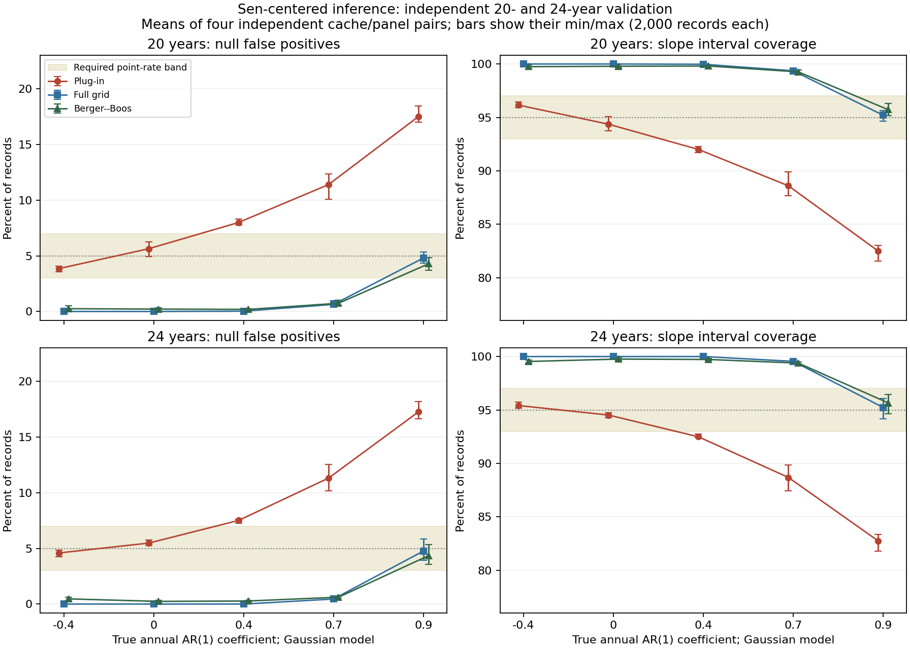

# Phase 4 checkpoint: Sen-centered Berger--Boos confidence sets

15 November 2026. **Focused experiment complete. Candidate fails the practical
release targets. Recommend descriptive-only use; stop method experimentation
at this checkpoint. Inference remains disabled. Phase 5 has not started.**

Theil--Sen remains the primary estimator. All 3,683 protected files are unchanged,
including source data, earlier numerical outputs/caches, preparation policies,
validated slopes, prior scientific code and previous reports. No NASA p-values
were computed for this experiment. The new work is synthetic and isolated.

## What was specified before evaluation

The [fixed protocol](PHASE_4_BERGER_BOOS_PROTOCOL.md), configuration and code
identities were hashed before calibration or validation. The JSON result
contains the identities and the preservation manifest; the local pre-evaluation
record is `data/derived/science_inference/berger_boos/protocol_before_evaluation.json`.
This is local prospective specification, not external preregistration.

Target beta in `Y_t=a+beta*t+e_t` with equally spaced annual years. The point
estimate is the exact validated Sen median of pair slopes. The unknown beta
is the interval target, not the realized sample estimate. Gaussian stationary
AR(1) is the candidate model; the same finite correlation grid -.5,-.4,...,.9
is retained. A Gaussian nuisance fit does not replace the Sen trend estimate.

At each grid rho, invert a simulated profile-REML score-difference test to
construct a **99.5% correlation confidence set**. Calibrate each rho against
9,999 independent Gaussian records with the complete grid refitted. Retain
all rho values whose conservative plus-one p-value exceeds **gamma=.005**.
No asymptotic chi-square approximation, fitted-rho shortcut or filling of holes.
Empty sets would conservatively use the full grid; none occurred.

Use independent simulations for the Sen/detrended-MAD pivot at every rho.
For a tested beta0, `p_BB=min(1,max_{rho in C} p_r(beta0)+.005)`, evaluated at
**alpha=.05**. The budget is **.005 nuisance exclusion + .045 trend error = .05**.
The 95% interval exactly inverts this rank rule and is centered on Sen. No
significance threshold was relaxed. The observed set and trend statistic can
be dependent; the union-bound argument does not assume otherwise.

Under a true Gaussian rho exactly on the grid, this construction has a
finite-simulation unconditional level bound. It does **not** establish validity
conditional on a particular reused cache, for continuous rho between points,
beyond the grid, or for a misspecified error process. Theoretical type-I
control is also different from achieving the project's practical 5%/95% targets.

Unchanged acceptance screens: null rejection 3--7%; coverage 93--97%; null
Wilson upper <=8%; coverage Wilson lower >=90%; alternative power Wilson
lower >=20%; zero numerical failures; all required scenarios/cache panels.
Extra nuisance-set screens are in the protocol; they do not enlarge gamma.
No parameter, cache, grid, method or NASA region was selected after results.

## Independent validation and accounting

Four independent cache/panel pairs, lengths 20/24, eleven noise scenarios,
2,000 records per panel, and slopes -.08/0/+.08 synthetic units/year. Calibration
seed 602917 and validation seed 1834901 are distinct from earlier studies.
Correlation-set and Sen-pivot simulations have separate stream identifiers.
There are **2,399,760 calibration records**, **176,000 unique validation noise
records** and **1,584,000 paired method/trend record evaluations** (792 summaries).
Methods and trend signs share noise panels; those evaluations are not independent
datasets. All increasing/decreasing coverage and power results are retained.

Plug-in and full-grid methods use their existing unchanged implementations on
the fresh panels with the same new Sen-pivot caches. Their earlier results stay
frozen. Their historical interval quantile convention is retained; no observed
p/interval disagreement occurred in this run. The new method uses exact rank
inversion; no disagreements occurred there either.

Tables show means across four independent cache/panel pairs. Per-panel Wilson
intervals and cache/panel min/max and cluster-t Monte Carlo intervals are in
[the numerical checkpoint](PHASE_4_BERGER_BOOS_RESEARCH.json). Four clusters
give imprecise Monte Carlo uncertainty; they are not 8,000 independent cache
estimates. These ranges are simulation diagnostics, not NASA confidence intervals.

## Paired comparison under the specified Gaussian model

Power columns correspond to the known slopes **-.08 / +.08**, respectively.
Both use marginal Gaussian noise SD one; they are not physical NASA thresholds.
Coverage is the same across the three slopes by tested affine equivariance.

| Years | Noise model / AR coefficient | Method | False positives % | Coverage % | Power - / + % |
|---|---|---|---|---|---|
| 20 | gaussian_negative4 (-0.4) | Plug-in | 3.85 | 96.15 | 57.71 / 58.14 |
| 20 | gaussian_negative4 (-0.4) | Full grid | 0.00 | 100.00 | 0.09 / 0.05 |
| 20 | gaussian_negative4 (-0.4) | Berger--Boos | 0.25 | 99.75 | 12.14 / 12.54 |
| 20 | gaussian0 (0) | Plug-in | 5.64 | 94.36 | 40.70 / 38.80 |
| 20 | gaussian0 (0) | Full grid | 0.00 | 100.00 | 0.22 / 0.10 |
| 20 | gaussian0 (0) | Berger--Boos | 0.21 | 99.79 | 3.36 / 3.31 |
| 20 | gaussian4 (0.4) | Plug-in | 8.00 | 92.00 | 26.80 / 26.64 |
| 20 | gaussian4 (0.4) | Full grid | 0.03 | 99.98 | 0.47 / 0.54 |
| 20 | gaussian4 (0.4) | Berger--Boos | 0.19 | 99.81 | 1.27 / 1.25 |
| 20 | gaussian7 (0.7) | Plug-in | 11.40 | 88.60 | 23.43 / 24.30 |
| 20 | gaussian7 (0.7) | Full grid | 0.64 | 99.36 | 2.86 / 2.95 |
| 20 | gaussian7 (0.7) | Berger--Boos | 0.74 | 99.26 | 2.77 / 2.86 |
| 20 | grid_boundary9 (0.9) | Plug-in | 17.51 | 82.49 | 31.31 / 31.59 |
| 20 | grid_boundary9 (0.9) | Full grid | 4.80 | 95.20 | 13.69 / 13.89 |
| 20 | grid_boundary9 (0.9) | Berger--Boos | 4.27 | 95.72 | 12.68 / 12.85 |
| 24 | gaussian_negative4 (-0.4) | Plug-in | 4.59 | 95.41 | 85.07 / 85.33 |
| 24 | gaussian_negative4 (-0.4) | Full grid | 0.00 | 100.00 | 0.05 / 0.05 |
| 24 | gaussian_negative4 (-0.4) | Berger--Boos | 0.46 | 99.54 | 36.48 / 37.24 |
| 24 | gaussian0 (0) | Plug-in | 5.47 | 94.52 | 60.65 / 61.45 |
| 24 | gaussian0 (0) | Full grid | 0.00 | 100.00 | 0.15 / 0.16 |
| 24 | gaussian0 (0) | Berger--Boos | 0.24 | 99.76 | 10.45 / 9.81 |
| 24 | gaussian4 (0.4) | Plug-in | 7.51 | 92.49 | 38.95 / 38.14 |
| 24 | gaussian4 (0.4) | Full grid | 0.00 | 100.00 | 0.71 / 0.68 |
| 24 | gaussian4 (0.4) | Berger--Boos | 0.27 | 99.72 | 2.43 / 2.33 |
| 24 | gaussian7 (0.7) | Plug-in | 11.31 | 88.69 | 29.80 / 29.59 |
| 24 | gaussian7 (0.7) | Full grid | 0.45 | 99.55 | 4.00 / 3.61 |
| 24 | gaussian7 (0.7) | Berger--Boos | 0.61 | 99.39 | 4.03 / 3.74 |
| 24 | grid_boundary9 (0.9) | Plug-in | 17.26 | 82.74 | 35.26 / 35.06 |
| 24 | grid_boundary9 (0.9) | Full grid | 4.76 | 95.24 | 18.43 / 17.91 |
| 24 | grid_boundary9 (0.9) | Berger--Boos | 4.34 | 95.66 | 17.29 / 17.01 |



At rho=.7, Berger--Boos false positives are **0.74% / 0.61%** and coverage
**99.26% / 99.39%** for 20/24 years. Positive-trend power is **2.86% / 3.74%**;
negative-trend power **2.77% / 4.03%**. Null false-positive cache/panel ranges
are .55--1.00% / .50--.70%; approximate cluster-mean Monte Carlo intervals
are .41--1.06% / .48--.75%. The practical failure is not close to a 3% lower
false-positive target or 20% lower power screen.

At the upper grid point .9, false positives (4.27% / 4.34%) and coverage
(95.72% / 95.66%) are close to target, but positive power is only 12.85% / 17.01%.
This favorable null case cannot override failures elsewhere. Independent errors
also remain too conservative: false positives .21% / .24%, coverage 99.79% /
99.76%. Negative dependence does not rescue all screens.

| Method | Failed core cache/scenario screens | Failed all cache/scenario screens |
|---|---|---|
| Plug-in | 72 / 120 | 212 / 264 |
| Full grid | 112 / 120 | 256 / 264 |
| Berger--Boos | 112 / 120 | 251 / 264 |

Every method fails release. These counts include paired slopes and reused
caches and must not be treated as independent failure probabilities.

## Did the correlation confidence set work?

Its prespecified diagnostic screens passed. Mean exclusion at exact-grid
Gaussian truths ranges from .40% to .59%, near the .5% budget. All per-cache
screens passed. This finite experiment supports the implementation under the
specified model; it does not prove general or conditional-on-cache calibration.

| Years | True Gaussian rho | Mean set size / 15 | True-rho exclusion % | Upper .9 included % |
|---|---|---|---|---|
| 20 | -0.4 | 9.41 | 0.55 | 9.30 |
| 20 | 0 | 13.06 | 0.54 | 58.16 |
| 20 | 0.4 | 12.27 | 0.59 | 94.08 |
| 20 | 0.7 | 10.00 | 0.41 | 98.89 |
| 20 | 0.9 | 8.51 | 0.45 | 99.55 |
| 24 | -0.4 | 8.34 | 0.46 | 2.88 |
| 24 | 0 | 12.20 | 0.40 | 36.81 |
| 24 | 0.4 | 11.59 | 0.48 | 88.94 |
| 24 | 0.7 | 9.08 | 0.49 | 98.09 |
| 24 | 0.9 | 7.30 | 0.53 | 99.48 |

At rho=.7, the sets retain roughly **10.00 / 9.08 of 15 rho values** and include
.9 for **98.91% / 98.12%** of records. Short records with an unknown trend
provide too little information to exclude highly dependent errors at 99.5%
confidence. Maximization therefore often resembles the conservative full-grid
envelope; adding gamma can even make it slightly wider. Sometimes confidence-
set restriction improves power, especially for negative dependence, but it does
not recover the required coverage/calibration/power combination.

The evidence points to weak nuisance identification and a worst-case tail
penalty, not a demonstrated failure of the error-budget principle. We do not
try a larger gamma, narrower grid or favorable seed after seeing this outcome.
Finite grid resolution remains a separate, unresolved scientific limitation.

## Misspecification, off-grid and boundary stresses

The seasonal case adds a repeating monthly cycle after calendar-day-weighted
annual aggregation; it does not validate raw monthly inference. Student5 has
standardized t5 innovations. ARMA uses AR .7 and MA .4: .7 is **not** its lag-one
correlation. Heteroskedastic innovations grow in scale from one to two. These
tests keep the linear slope target but challenge the Gaussian AR(1) assumptions.

| Years | Noise model / AR coefficient | Method | False positives % | Coverage % | Power - / + % |
|---|---|---|---|---|---|
| 20 | offgrid55 (0.55) | Berger--Boos | 0.23 | 99.78 | 1.47 / 1.29 |
| 20 | seasonal (0.7) | Berger--Boos | 0.79 | 99.21 | 2.66 / 2.99 |
| 20 | student5 (0.7) | Berger--Boos | 0.80 | 99.20 | 3.56 / 3.35 |
| 20 | arma11 (0.7) | Berger--Boos | 1.35 | 98.65 | 2.77 / 2.85 |
| 20 | heteroskedastic (0.7) | Berger--Boos | 0.62 | 99.38 | 1.74 / 1.65 |
| 20 | outside95 (0.95) | Berger--Boos | 7.53 | 92.48 | 25.10 / 24.18 |
| 24 | offgrid55 (0.55) | Berger--Boos | 0.26 | 99.74 | 2.52 / 2.16 |
| 24 | seasonal (0.7) | Berger--Boos | 0.60 | 99.40 | 4.03 / 4.04 |
| 24 | student5 (0.7) | Berger--Boos | 0.56 | 99.44 | 4.89 / 5.31 |
| 24 | arma11 (0.7) | Berger--Boos | 0.91 | 99.09 | 3.58 / 3.25 |
| 24 | heteroskedastic (0.7) | Berger--Boos | 0.43 | 99.58 | 1.75 / 2.05 |
| 24 | outside95 (0.95) | Berger--Boos | 8.81 | 91.19 | 31.23 / 31.87 |

The off-grid .55 case remains far too conservative; it supplies no theorem for
the continuum. Heavy tails, ARMA and changing variance also fail the practical
screens. Outside-grid rho=.95 yields **7.53% / 8.81%** false positives and
**92.48% / 91.19%** coverage. Here the true rho cannot belong to the finite set,
so the finite-grid union-bound premise is absent. Narrowing a grid to improve
power cannot be treated as protection against stronger persistence.

JSON `excluded` values for non-Gaussian grid-indexable stresses describe exclusion
of the generating AR coefficient only; they are not validated nuisance coverage
for those misspecified models. Off-grid/outside-grid exclusion is null, not
an invented coverage rate. The separate range-bracketing metric is descriptive.

No results establish robustness to nonlinear trends, asymmetric errors, severe
outliers, nonstationarity, missing years, changing spatial support or multiple
cell testing. A robust descriptive estimator does not make its parametric
uncertainty method robust to every error process.

## Practical recommendation: a descriptive-only application

**Reject this candidate for release and end this sequence of method searches.**
The existing data and validated descriptive work remain useful. Recommend this
bounded application scope for owner review, without implementing Phase 5 now:

1. Use the existing Phase 3 regional Sen slopes with explicit variable units,
   units/year, dates and observed record counts. Keep raw monthly, monthly
   anomaly and complete-annual summaries separately labeled. Show observed
   series and a labeled descriptive trend summary; do not imply forecasts.
2. Keep Strict 100% as the unchanged default/control. Present Standard 100%
   separately as preparation-policy sensitivity. Label Standard 95% experimental;
   expose monthly valid-area support, preserve missing cell-years, and never
   present its incomplete cell-years as complete annual observations.
3. Carry forward provenance, QA, eligible/excluded area denominators, month/year
   completeness and changing-support warnings from existing artifacts. A
   regional slope describes the selected contributing footprint and period.
4. Offer policy and period sensitivity as **descriptive comparisons**, using
   approved existing definitions. A spread across cells, periods or policies
   is not a confidence interval and does not measure a calibrated error rate.
5. Display `Inference unavailable: short-record uncertainty validation did not
   meet release targets`. Withhold p-values, confidence bands, significant/
   non-significant labels, FDR decisions, confidence rankings and significance
   shares. Increasing/decreasing descriptive signs do not establish certainty
   or causation; a failed/inconclusive inference method does not imply stability.
6. Seek review of this descriptive-only scope before subsequent integration or
   Phase 5 work. Further method research needs a new, explicitly bounded
   scientific decision; this report does not authorize more experimentation.

This rejects the configured method for the tested product scope, not every
possible uncertainty method or the value of the data. The fixed power benchmark
is a practical requirement, not a claim that all real physical trends of that
magnitude are detectable in 20 years.

This is a product recommendation, not a completed application release. Inference
flags remain false, no scientific method is frozen as approved, and Phase 5
remains NOT_STARTED. The user's existing phase boundaries are preserved.

## Verification and reproduction

**110 software tests pass**; seven new tests cover dense-covariance score
references, affine invariance, exact rank inversion/ties, explicit budget and
manual maximization, missing/degenerate guards and stationary AR simulation.
The saved-evidence validator recomputes all 88 new-candidate panels, checks
all 792 record-level summaries and all aggregate arithmetic, and verifies
264 independent SciPy Sen comparisons (maximum absolute slope error zero).
Zero numerical failures and zero new-candidate test/interval disagreements.
Passing these checks does not reverse the failed scientific screens.

The validator verifies 96 saved evidence files, the pre-evaluation protocol and
all 3,683 protected prior files by SHA-256. Earlier NASA data, Stage 2/3 arrays,
all previous Phase 4 results and previous code/configuration/tests are unchanged.
Only this experiment's new files and current plan/progress documentation change.

From the repository root:

```powershell
.\.venv\Scripts\python.exe tools/research_berger_boos.py
.\.venv\Scripts\python.exe tools/validate_berger_boos.py
.\.venv\Scripts\python.exe tools/render_berger_boos_checkpoint.py
```

The runner writes new caches and record-level evidence under ignored
`data/derived/science_inference/berger_boos/`. Committed JSON retains all scenario
summaries, acceptance rules, seeds and preservation/evidence hashes. Old studies
are not rerun or overwritten. Reproduction is not a proposed new method search.

## References and prior evidence

Confidence-set maximization with an added error budget follows
[Berger and Boos (1994)](https://doi.org/10.1080/01621459.1994.10476836).
[Dufour (2006)](https://jeanmariedufour.research.mcgill.ca/Dufour_2006_JE_MCT.pdf)
discusses finite-sample Monte Carlo tests with nuisance maximization and the
limits of plug-in approaches. Neither source validates our particular Sen/MAD
pivot or grid. The union-bound application and simulation results above are
this experiment's derivation and evidence, not claims copied from those papers.

Earlier [Sen comparisons](PHASE_4_SEN_REPORT.md) and
[double-bootstrap diagnosis](PHASE_4_DOUBLE_DIAGNOSIS_REPORT.md) remain intact.
Machine-readable evidence: [research](PHASE_4_BERGER_BOOS_RESEARCH.json) and
[verification](PHASE_4_BERGER_BOOS_TESTS.json).
